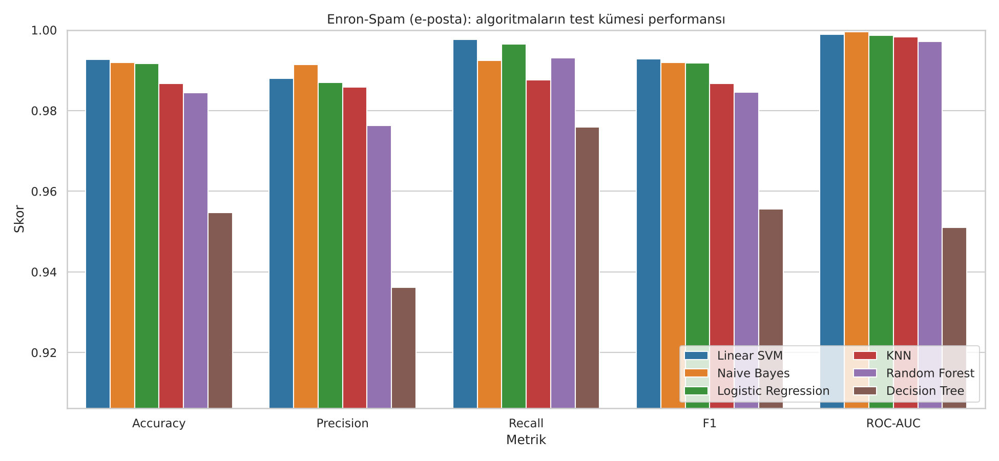
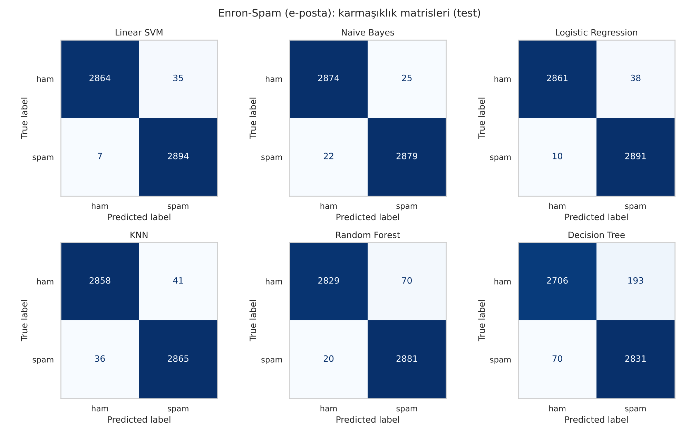
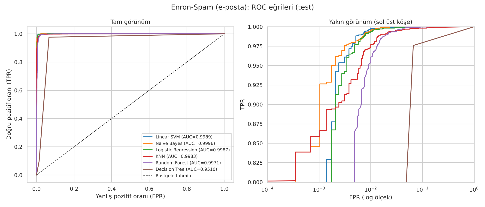
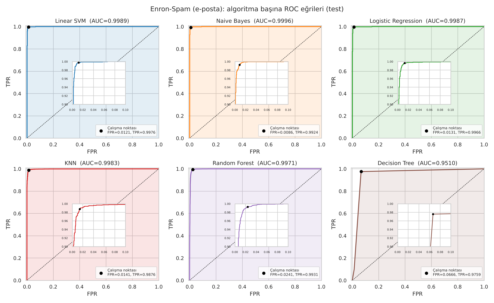
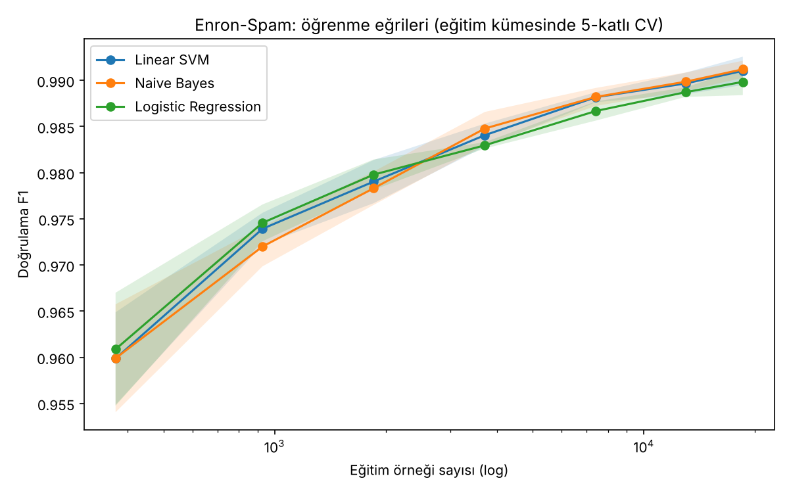
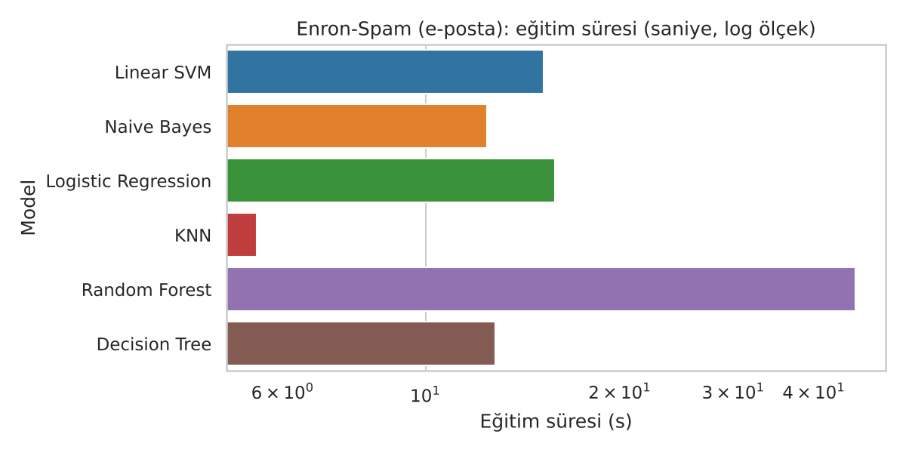
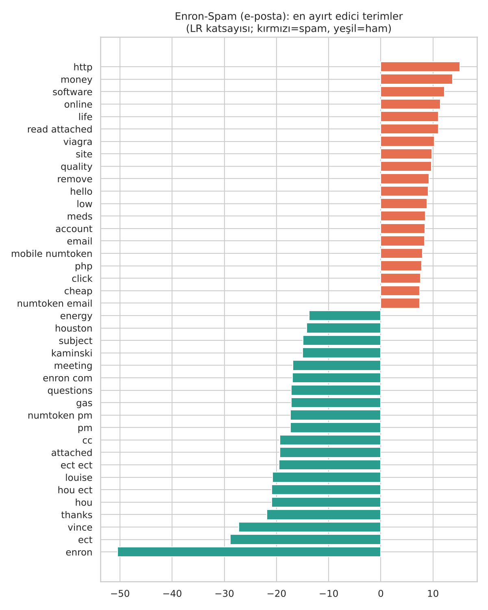

# Spam / Normal E-posta Sınıflandırma — Yapay Zeka Ödevi

> **Ödev 1:** Spam veya normal mail veri seti bulunacak, en az 3 makine öğrenmesi algoritmasıyla
> eğitilecek, gerekli test işlemlerinden sonra en iyi sonucu veren algoritma belirlenecek.
>
> **Ödev 2** (doğruluğu artırma yöntemleri + her algoritmanın ROC eğrileri) →
> [`avucluhocaodev2/`](avucluhocaodev2/README.md) — ön işleme/TF-IDF, n-gram ve karakter özellikleri,
> özellik seçimi + hiperparametre optimizasyonu, karar eşiği optimizasyonu ve topluluk yöntemleriyle
> doğruluk **%98,98 → %99,48**'e (Stacking) çıkarılmış, her algoritmanın ROC eğrisi çizilmiştir.
>
> **Flutter ödevi** (register + login ekranı, giriş yapınca "Merhaba Hakan") →
> [`flutter_odev/`](flutter_odev/README.md) — kayıt/giriş akışının üzerine ders, ödev, not ortalaması (GANO),
> pomodoro odak sayacı ve istatistik ekranlarıyla genişletilmiş "Avuçlu Hoca" öğrenci asistanı uygulaması.

## Sonuç (özet)

**En iyi algoritma: Linear SVM (Doğrusal Destek Vektör Makinesi)**
— Enron-Spam test kümesinde **Accuracy = %99,28**, **F1 = 0,9928**, **ROC-AUC = 0,9989**.

| Sıra | Algoritma | CV F1 (5-kat) | Accuracy | Precision | Recall | **F1** | ROC-AUC | Eğitim (s) |
|---:|---|---:|---:|---:|---:|---:|---:|---:|
| 1 | **Linear SVM** | 0,9910 ± 0,0015 | **0,9928** | 0,9881 | **0,9976** | **0,9928** | 0,9989 | 9,4 |
| 2 | Naive Bayes (Multinomial) | 0,9912 ± 0,0009 | 0,9919 | **0,9914** | 0,9924 | 0,9919 | **0,9996** | 7,6 |
| 3 | Logistic Regression | 0,9898 ± 0,0014 | 0,9917 | 0,9870 | 0,9966 | 0,9918 | 0,9987 | 10,5 |
| 4 | K-En Yakın Komşu (KNN) | 0,9840 ± 0,0010 | 0,9867 | 0,9859 | 0,9876 | 0,9867 | 0,9983 | 3,4 |
| 5 | Random Forest | 0,9836 ± 0,0014 | 0,9845 | 0,9763 | 0,9931 | 0,9846 | 0,9971 | 23,6 |
| 6 | Decision Tree | 0,9498 ± 0,0020 | 0,9547 | 0,9362 | 0,9759 | 0,9556 | 0,9510 | 10,7 |

*Test kümesi: 5.800 e-posta (2.899 ham, 2.901 spam). Tam çıktı: [`results/results.csv`](results/results.csv),
[`results/best_model.txt`](results/best_model.txt), [`results/run_log.txt`](results/run_log.txt).*

**Yorum**

* Metin sınıflandırmada **doğrusal modeller** (Linear SVM, Naive Bayes, Logistic Regression) açık ara öndedir;
  TF-IDF ile elde edilen on binlerce boyutlu seyrek uzayda sınıflar neredeyse doğrusal olarak ayrılabilir.
* Linear SVM 5.800 test e-postasından yalnızca **42'sini** yanlış sınıflamıştır (35 yanlış alarm, 7 kaçan spam).
* İlk üç model arasındaki fark çok küçüktür. **McNemar testi** (aynı test örnekleri üzerinde eşleştirilmiş
  karşılaştırma) Linear SVM'in Naive Bayes (p = 0,53) ve Logistic Regression (p = 0,24) karşısındaki
  üstünlüğünün istatistiksel olarak anlamlı **olmadığını**, KNN, Random Forest ve Decision Tree karşısındaki
  üstünlüğünün ise **anlamlı** (p < 0,001) olduğunu gösterir → [`results/mcnemar.csv`](results/mcnemar.csv).
* ROC-AUC'ye (sıralama kalitesi) göre en iyisi Naive Bayes'tir (0,9996); yani Naive Bayes skorları,
  karar eşiği ayarlandığında çok güçlü bir sınıflandırıcıdır. Bu konu Ödev 2'de incelenmiştir.
* Tek bir karar ağacı aşırı öğrenmeye (overfitting) yatkın olduğu için en zayıf modeldir; aynı ağaçların
  topluluğu olan Random Forest hatayı ~%4,5'ten ~%1,5'e indirir.

## 1. Veri seti

| | Enron-Spam (ana veri seti) | SMS Spam Collection (genelleme kontrolü) |
|---|---|---|
| Kaynak | Metsis, Androutsopoulos & Paliouras (2006), [MWiechmann/enron_spam_data](https://github.com/MWiechmann/enron_spam_data) | Almeida, Gómez Hidalgo & Yamakami (2011), UCI ML Repository |
| İçerik | Enron şirketi çalışanlarının gerçek e-postaları + spam tuzaklarından toplanmış spam'ler | Cep telefonu SMS'leri |
| Ham kayıt | 33.716 (17.171 spam, 16.545 ham) | 5.574 (747 spam, 4.827 ham) |
| Temizlik sonrası | **29.000** (14.506 spam, 14.494 ham) | 5.095 (595 spam, 4.500 ham) |
| Dosya | [`data/enron_spam_data.zip`](data/enron_spam_data.zip) | [`data/sms.tsv`](data/sms.tsv) |

Ödev "mail" veri seti istediği için ana deney **gerçek e-postalardan** oluşan Enron-Spam üzerinde yapılmıştır.
SMS veri seti, yöntemin farklı ve dengesiz (%12 spam) bir veri setinde de çalıştığını göstermek için
ikincil olarak kullanılmıştır.

## 2. Yöntem

```
ham e-posta ──► temizleme ──► tekrar atma ──► %80 eğitim / %20 test (stratified)
                                                  │
              ┌───────────────────────────────────┘
              ▼
      TF-IDF (1-2 gram) ──► 6 algoritma ──► 5-katlı CV + GridSearch (eğitim kümesinde)
                                                  │
                                                  ▼
                         en iyi parametrelerle yeniden eğitim ──► test kümesinde değerlendirme
                                                  │
                                                  ▼
                       metrikler + karmaşıklık matrisi + ROC + McNemar ──► en iyi algoritma
```

1. **Ön işleme** ([`spam_classification.py`](spam_classification.py) → `clean_text`, `prepare`)
   * Konu + gövde birleştirilir, küçük harfe çevrilir.
   * URL → `urltoken`, e-posta adresi → `emailtoken`, sayılar → `numtoken`; harf dışı karakterler silinir.
   * Boş metinler (52) ve **tekrarlı metinler (4.664)** atılır. Tekrarlar atılmazsa aynı e-posta hem eğitimde
     hem testte bulunur ve sonuçlar olduğundan iyi görünür (veri sızıntısı).
2. **Eğitim/test ayrımı:** Sınıf oranı korunarak (%80 / %20, `random_state=42`) — 23.200 eğitim, 5.800 test.
3. **Öznitelik çıkarımı:** `TfidfVectorizer(stop_words="english", sublinear_tf=True, min_df=2, max_df=0.95)`;
   n-gram aralığı GridSearch ile seçilir.
4. **Algoritmalar** (en az 3 şartı → 6 algoritma):

   | Algoritma | Kısa açıklama | Aranan hiperparametreler | Seçilen |
   |---|---|---|---|
   | Multinomial Naive Bayes | Bayes teoremi, kelimelerin koşullu bağımsız olduğu varsayımı | `alpha` ∈ {0.01, 0.1, 1}, n-gram ∈ {(1,1), (1,2)} | alpha=0.01, (1,2) |
   | Logistic Regression | Doğrusal model + sigmoid ile olasılık | `C` ∈ {1, 10, 100}, n-gram | C=100, (1,2) |
   | Linear SVM | Sınıflar arasındaki marjı en büyükleyen hiper-düzlem | `C` ∈ {0.1, 1, 10}, n-gram | C=10, (1,2) |
   | KNN | En yakın k komşunun çoğunluk oyu (kosinüs uzaklığı) | `k` ∈ {3, 7, 15} | k=15 |
   | Decision Tree | Eğer-ise kurallarından oluşan tek ağaç | `max_depth` ∈ {None, 60}, `min_samples_leaf` ∈ {1, 3} | 60, 1 |
   | Random Forest | 300 ağaçlı bagging topluluğu | `min_samples_leaf` ∈ {1, 2} | 1 |

5. **Test işlemleri**
   * **5-katlı tabakalı çapraz doğrulama** (yalnızca eğitim kümesinde) ile hiperparametre seçimi ve
     modelin kararlılığının ölçülmesi (CV F1 ort. ± std).
   * Hiç görülmemiş **test kümesinde**: Accuracy, Precision, Recall, F1, ROC-AUC, karmaşıklık matrisi,
     eğitim ve tahmin süreleri.
   * **McNemar testi** ile en iyi model ve diğerleri arasındaki farkın istatistiksel anlamlılığı.
   * **Hata analizi:** en iyi modelin yanlış sınıfladığı e-postalar →
     [`results/misclassified_samples.csv`](results/misclassified_samples.csv).
   * **Genelleme kontrolü:** aynı süreç SMS veri setinde tekrarlanmıştır.
6. **Seçim ölçütü:** Spam/ham sınıfları dengeli olduğu ve hem yanlış alarmı hem kaçan spam'i birlikte
   cezalandırdığı için **test F1** skoru (eşitlikte Accuracy).

## 3. Grafikler

| | |
|---|---|
|  |  |
|  |  |
|  |  |

**En ayırt edici kelimeler** (Logistic Regression katsayıları): spam tarafında `http`, `money`, `software`,
`online`, `viagra`, `click`, `cheap`; ham tarafında `enron`, `vince`, `ect`, `hou`, `meeting`, `attached`, `thanks`.



> **Not:** Ham tarafındaki en güçlü kelimeler (`enron`, `vince`, `kaminski`, `hou`, `ect`) şirkete özgüdür.
> Bu, modelin "bu e-posta Enron çalışanına mı ait?" sorusunu da öğrendiğini gösterir; model başka bir kurumun
> e-postalarına uygulanırken yeniden eğitilmelidir. Bu durum Enron-Spam veri setinin bilinen bir sınırlılığıdır.

## 4. Genelleme kontrolü — SMS Spam Collection

| Algoritma | Enron F1 | SMS F1 | SMS Accuracy |
|---|---:|---:|---:|
| **Linear SVM** | **0,9928** | **0,9292** | **0,9843** |
| Logistic Regression | 0,9918 | 0,9204 | 0,9823 |
| Naive Bayes | 0,9919 | 0,9099 | 0,9804 |
| KNN | 0,9867 | 0,8930 | 0,9774 |
| Random Forest | 0,9846 | 0,8837 | 0,9755 |
| Decision Tree | 0,9556 | 0,8407 | 0,9647 |

Linear SVM, çok daha kısa metinlerden oluşan ve dengesiz olan SMS veri setinde de birinci olmuştur;
algoritmaların sıralaması iki veri setinde neredeyse aynıdır. Bu, sonucun tek bir veri setine özgü olmadığını
gösterir. Ayrıntılar: [`results/sms/`](results/sms).

## 5. Dosya yapısı

```
├── spam_classification.py        # Ana deney: veri, ön işleme, 6 algoritma, CV, test, grafikler
├── spam_classification.ipynb     # Adım adım, çıktılarıyla çalıştırılmış not defteri
├── predict.py                    # Kaydedilen en iyi modelle yeni e-posta sınıflandırma
├── scripts/
│   ├── build_notebook.py         # Not defterini üretir ve çalıştırır
│   └── learning_curve.py         # Öğrenme eğrisi (eğitim boyutu → F1)
├── tests/test_pipeline.py        # Birim testleri (pytest)
├── data/                         # Enron-Spam ve SMS veri setleri
├── results/                      # Tablolar, grafikler, raporlar, en iyi model (best_model.joblib)
│   └── sms/                      # SMS veri seti sonuçları
└── avucluhocaodev2/              # Ödev 2: doğruluğu artırma yöntemleri + ROC eğrileri
    ├── improve_accuracy.py       #   deney betiği (A0-A4 aşamaları + topluluklar)
    ├── improve_accuracy.ipynb    #   sonuç not defteri
    └── results/                  #   tablolar, ROC grafikleri, McNemar testleri
```

## 6. Çalıştırma

```bash
pip install -r requirements.txt

python spam_classification.py            # tam deney (Enron + SMS), ~25 dk (4 çekirdek)
python spam_classification.py --quick    # hızlı deneme (~1 dk)
python scripts/learning_curve.py         # öğrenme eğrisi
python scripts/build_notebook.py         # not defterini yeniden üret
pytest -q                                # birim testleri

# Yeni bir e-postayı sınıflandırma
python predict.py "Congratulations! You won a FREE iPhone. Click here to claim your prize"
python predict.py "Hi Vince, the meeting is moved to 3pm. Please review the attached agenda."
```

Örnek çıktı:

```
[SPAM] karar skoru=+0.919  (LinearSVC)  Congratulations! You won a FREE iPhone. Click here to claim your prize
[HAM ] karar skoru=-1.538  (LinearSVC)  Hi Vince, the meeting is moved to 3pm. Please review the attached agen
```

## Kaynaklar

* V. Metsis, I. Androutsopoulos, G. Paliouras. *Spam Filtering with Naive Bayes — Which Naive Bayes?* CEAS 2006.
* T. A. Almeida, J. M. Gómez Hidalgo, A. Yamakami. *Contributions to the Study of SMS Spam Filtering.* DocEng 2011.
* F. Pedregosa vd. *Scikit-learn: Machine Learning in Python.* JMLR 12, 2011.
* Q. McNemar. *Note on the sampling error of the difference between correlated proportions.* Psychometrika, 1947.
