# Ödev 2 — Doğruluğu Artırma Yöntemleri ve Her Algoritmanın ROC Eğrileri

> **Soru:** Elde ettiğimiz bu doğruluk oranını makine öğrenmesi algoritmalarında hangi yöntemleri kullanarak
> arttırabiliriz? Sonuçlarda her bir algoritmanın ROC eğrilerini oluşturacağız.
>
> Ödev 1 (veri seti + 6 algoritma + en iyi algoritma) → [ana README](../README.md)

## Sonuç (özet)

| | Doğruluk | Hatalı tahmin (5.800 e-postada) |
|---|---:|---:|
| En iyi **temel** model (A0: ham metin, kelime sayımı, varsayılan parametreler — Naive Bayes) | %98,98 | 59 |
| Ödev 1'in en iyi modeli (TF-IDF + GridSearch — Linear SVM) | %99,28 | 42 |
| En iyi **tek model** (Ödev 2 yöntemleriyle — Linear SVM / Logistic Regression) | %99,29 | 41 |
| **En iyi sonuç: Stacking topluluğu** (NB + LR + SVM → meta Logistic Regression) | **%99,48** | **30** |

Doğruluğu artırmak için uygulanan yöntemler ile hatalı tahmin sayısı **59'dan 30'a (%49 azalma)** inmiştir.
Ödev 1'deki en iyi modele göre hata sayısı 42'den 30'a düşmüştür (%29 azalma).

En büyük katkıyı sağlayan yöntemler (Enron-Spam):

1. **Topluluk öğrenmesi (Stacking / Soft Voting)** — farklı türde hatalar yapan modelleri birleştirmek: 41 → 30 hata.
2. **Hiperparametre optimizasyonu** — özellikle KNN (560 → 102 hata) ve Naive Bayes (69 → 43 hata).
3. **Özellik mühendisliği (kelime 1-2 gram + karakter n-gram + meta özellikler)** — Linear SVM (48 → 41) ve
   Logistic Regression (91 → 59).
4. **Metin ön işleme + TF-IDF** — Linear SVM (112 → 48 hata).
5. **Karar eşiği optimizasyonu** — küçük ama ücretsiz katkı (LR 45 → 41, KNN 102 → 96, RF 101 → 94).

## 1. Deney düzeni

Ödev 1 ile **aynı veri seti** (Enron-Spam, 29.000 tekil e-posta) ve **birebir aynı test kümesi** (5.800 e-posta)
kullanılmıştır; böylece sonuçlar doğrudan karşılaştırılabilir. Test kümesi hiçbir ayar adımında kullanılmamıştır:
tüm seçimler (hiperparametre, özellik sayısı, karar eşiği) yalnızca **eğitim kümesinde 3-katlı çapraz doğrulama**
ile yapılmıştır.

Her algoritmaya iyileştirme yöntemleri **adım adım ve birikimli** olarak eklenmiş, her adımın etkisi ayrı
ölçülmüştür (ablation çalışması):

| Aşama | Eklenen yöntem | Ayrıntı |
|---|---|---|
| **A0** | Temel model | Ham metin, `CountVectorizer` (kelime sayımı), algoritmaların varsayılan parametreleri |
| **A1** | + Ön işleme & TF-IDF | Küçük harf, URL/e-posta/sayı normalizasyonu, noktalama ve stop-word temizliği, alt-doğrusal TF-IDF ağırlığı |
| **A2** | + Özellik mühendisliği | Kelime 1-2 gram (200 bin) + karakter 3-5 gram (100 bin) + 11 meta özellik (uzunluk, büyük harf oranı, rakam oranı, `!` sayısı, para simgesi, URL, e-posta adresi, HTML etiketi, özel karakter oranı, ortalama kelime uzunluğu) → **300.011 özellik** |
| **A3** | + Özellik seçimi & hiperparametre optimizasyonu | Ki-kare (χ²) ile en bilgilendirici *k* özelliğin seçimi + `GridSearchCV` (3-katlı CV, ölçüt: doğruluk) |
| **A4** | + Karar eşiği optimizasyonu | Spam/ham eşiği (0,5 veya 0 yerine) eğitim kümesindeki *out-of-fold* skorlarla doğruluğu en büyükleyecek şekilde seçilir |
| **Topluluk** | + Ensemble yöntemleri | **Soft Voting** (NB+LR+SVM+RF olasılık ortalaması), **Stacking** (NB+LR+SVM tahminleri → meta Logistic Regression), **XGBoost**, **LightGBM** (gradient boosting) |

## 2. Sonuçlar — test doğruluğu

| Algoritma | A0 Temel | A1 +TF-IDF | A2 +Özellik müh. | A3 +Optimizasyon | A4 +Eşik | Hata azalması (A0→A4) |
|---|---:|---:|---:|---:|---:|---:|
| Logistic Regression | 0,9867 | 0,9843 | 0,9898 | 0,9922 | **0,9929** | %47 |
| Linear SVM | 0,9807 | 0,9917 | **0,9929** | 0,9926 | 0,9928 | %63 |
| Naive Bayes | 0,9898 | 0,9874 | 0,9881 | **0,9926** | **0,9926** | %27 |
| Random Forest | 0,9814 | **0,9857** | 0,9833 | 0,9826 | 0,9838 | %13 |
| KNN | 0,9060 | 0,6005 | 0,9034 | 0,9824 | **0,9834** | **%82** |
| Decision Tree | 0,9484 | **0,9607** | 0,9336 | 0,9402 | 0,9402 | −%16 |

| Topluluk yöntemi | Accuracy | F1 | ROC-AUC | Hata |
|---|---:|---:|---:|---:|
| **Stacking (meta: LR)** | **0,9948** | **0,9948** | **0,99958** | **30** |
| Soft Voting (NB+LR+SVM+RF) | 0,9947 | 0,9947 | 0,99947 | 31 |
| LightGBM | 0,9862 | 0,9863 | 0,99924 | 80 |
| XGBoost | 0,9833 | 0,9834 | 0,99908 | 97 |

Seçilen hiperparametreler (A3): NB `alpha=0.003`; LR `C=10`; SVM `C=10`; KNN `k=3` (kosinüs, uzaklık ağırlıklı);
DT `gini`, χ² ile 5.000 özellik; RF `max_features=sqrt`, 400 ağaç. Tüm ayrıntılar:
[`results/stage_results.csv`](results/stage_results.csv), [`results/summary.txt`](results/summary.txt),
[`results/run_log.txt`](results/run_log.txt).

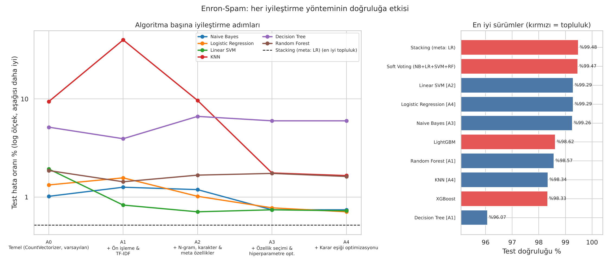
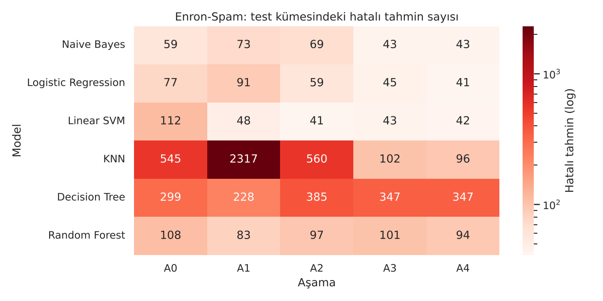

## 3. Her algoritmanın ROC eğrileri

Her grafikte bir algoritmanın **A0 → A3** aşamalarındaki ROC eğrileri birlikte çizilmiştir. Sol panel klasik ROC
eğrisidir; sağ panelde FPR ekseni **logaritmik** ölçektedir — modeller %99'un üzerinde olduğu için farklar ancak
sol üst köşe büyütüldüğünde görülür. Daire (●) varsayılan eşikteki, yıldız (★) optimize edilmiş eşikteki (A4)
çalışma noktasıdır.

| | |
|---|---|
| 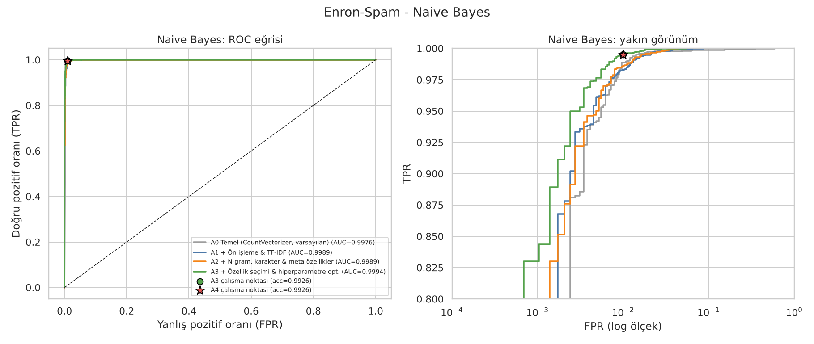 | 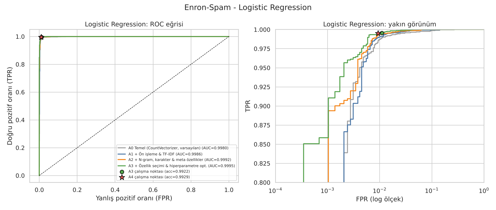 |
| 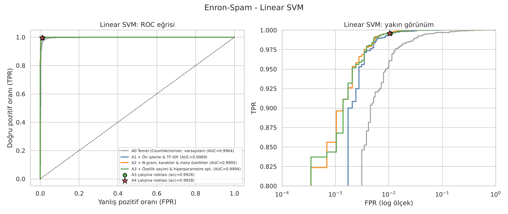 | 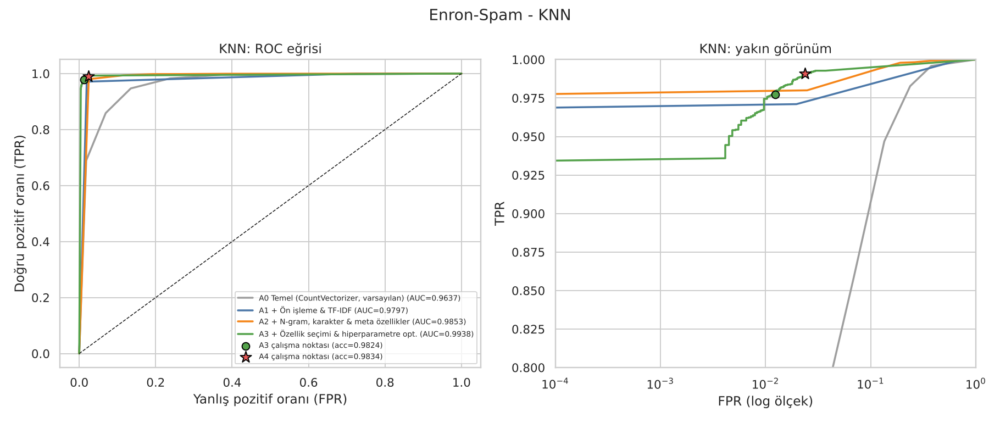 |
| 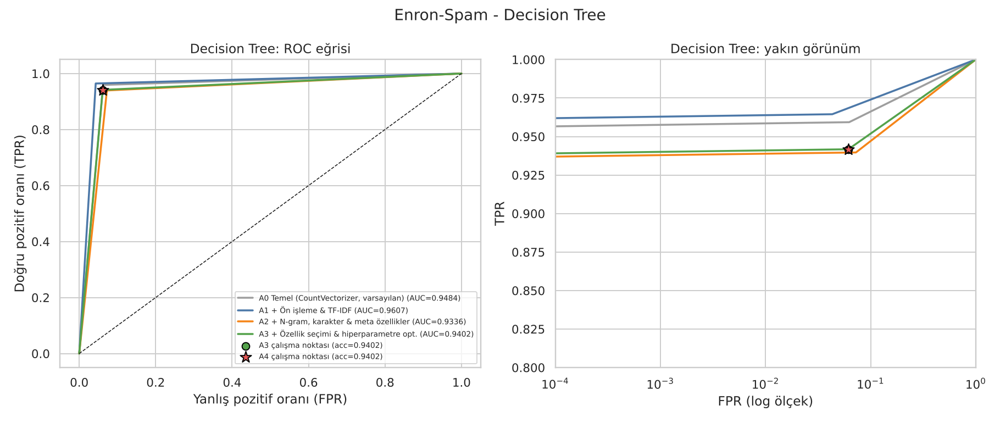 | 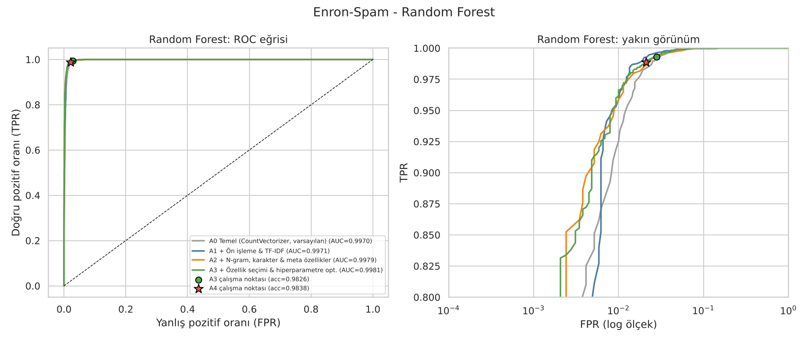 |

Tüm algoritmalar tek sayfada:

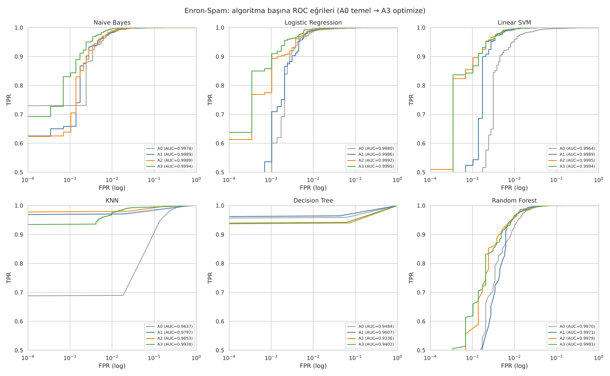

Optimize edilmiş modeller ve topluluk yöntemlerinin karşılaştırması:

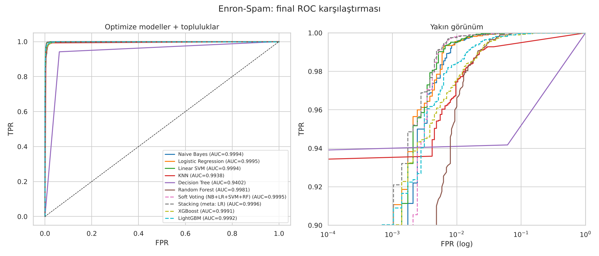

| Algoritma | AUC (A0) | AUC (A3) |
|---|---:|---:|
| Naive Bayes | 0,9976 | 0,9994 |
| Logistic Regression | 0,9980 | 0,9995 |
| Linear SVM | 0,9964 | 0,9994 |
| KNN | 0,9637 | 0,9938 |
| Decision Tree | 0,9484 | 0,9402 |
| Random Forest | 0,9970 | 0,9981 |
| **Stacking** | — | **0,9996** |

## 4. Yöntemlerin yorumu — doğruluğu neler artırır, neler artırmaz?

**1. Metin ön işleme ve TF-IDF (A1).** Kelime sayımı yerine TF-IDF, her e-postada sık geçen ama ayırt edici
olmayan kelimelerin ağırlığını düşürür. Linear SVM için hata 112'den 48'e iner; SVM ölçeğe duyarlı olduğu için
en çok bundan yararlanır. Naive Bayes ise zaten kelime sayımları üzerine kurulu bir olasılık modeli olduğu için
TF-IDF'ten fayda görmez (59 → 73 hata); varsayılan `C=1` ile Logistic Regression da TF-IDF'in küçük değerli
özelliklerinde fazla düzenlileştirilir (77 → 91 hata) — bu kayıp A3'teki `C` ayarıyla geri kazanılır. Yani
bir yöntemin faydası, algoritmanın diğer ayarlarıyla birlikte değerlendirilmelidir.

**2. Özellik mühendisliği (A2).** Kelime ikilileri ("click here", "free money") ve karakter n-gramları
("v1agra" gibi kasıtlı yazım hatalarını yakalar) dilin bağlamını modele katar. Doğrusal modeller (LR, SVM) yüksek
boyutlu seyrek uzayda iyi çalıştığı için bu adımdan kazançlı çıkar. Ağaç tabanlı modeller ve KNN ise 300 bin
özellik içinde kaybolur — **daha fazla özellik her algoritmaya yaramaz**; bu nedenle bir sonraki adımda özellik
seçimi gerekir.

**3. Özellik seçimi + hiperparametre optimizasyonu (A3).** Doğru hiperparametre, en ucuz ve en etkili
iyileştirmelerden biridir:
* **KNN**: varsayılan ayarlarla (Öklid uzaklığı, k=5, eşit oy) yüksek boyutta "hubness" sorunu yaşanır — bazı
  spam e-postalar çok sayıda e-postanın en yakın komşusu olur ve A1'de KNN e-postaların ~%90'ını spam olarak
  işaretler (doğruluk %60). **Kosinüs benzerliği + uzaklığa göre ağırlıklandırma + k ayarı** ile hata 560'tan
  102'ye düşer.
* **Naive Bayes**: düzeltme parametresi `alpha` 1,0'dan 0,003'e indirildiğinde nadir ama ayırt edici kelimelerin
  etkisi artar (69 → 43 hata).
* **Logistic Regression**: `C=10` (daha az düzenlileştirme) 300 bin özellikli uzayda modelin kapasitesini artırır.

**4. Karar eşiği optimizasyonu (A4).** ROC eğrisi değişmez; yalnızca eğri üzerindeki çalışma noktası kaydırılır.
Sınıflar dengeli olduğu için kazanç küçüktür (birkaç hata), ancak hiçbir ek eğitim maliyeti yoktur. Sınıfların
dengesiz olduğu durumlarda (ör. SMS veri seti) veya yanlış alarmın maliyeti yüksek olduğunda (önemli bir e-postanın
spam klasörüne düşmesi) çok daha önemli hale gelir; ROC eğrisi tam olarak bu seçimi yapmak için kullanılır.

**5. Topluluk öğrenmesi (Ensemble).** En büyük son adım kazancı buradan gelir. Naive Bayes (üretken model),
Logistic Regression ve SVM (ayırt edici modeller) **farklı e-postalarda hata yapar**; Stacking, hangi modele ne
zaman güveneceğini bir meta-model ile öğrenir. Sonuç: tek başına en iyi modelin 41 hatası → **30 hata**.
Gradient boosting (XGBoost, LightGBM) ise binlerce seyrek kelime özelliği üzerinde doğrusal modellerin gerisinde
kalmıştır — tablo verisinde çok güçlü olan bu yöntemler, seyrek metin verisinde doğrusal modellere üstün gelemez.

**6. Decision Tree neden iyileşmedi?** Tek bir karar ağacı yüksek varyanslı bir modeldir: verideki küçük
değişiklikler tamamen farklı bir ağaç üretir ve ağaç her zaman 0/1 olasılık verdiği için ROC eğrisi tek bir
köşeden oluşur. Ağacın doğruluğunu artırmanın asıl yolu **birçok ağacı birleştirmektir**: Random Forest
(bagging) hatayı 347'den ~95'e indirir. Yani Decision Tree için en etkili "iyileştirme yöntemi" topluluk
öğrenmesidir.

**7. Daha fazla veri.** Ödev 1'in [öğrenme eğrisi](../results/learning_curve.png), eğitim verisi arttıkça doğruluğun
hâlâ yükseldiğini gösterir (ör. Linear SVM'in doğrulama F1 skoru: 3.712 örnekle 0,984 → 18.560 örnekle 0,991). Etiketli veri
toplamak da en güvenilir iyileştirme yöntemlerinden biridir.

### Özet tablo — hangi yöntem hangi algoritmaya yarar?

| Yöntem | NB | LR | SVM | KNN | DT | RF |
|---|:-:|:-:|:-:|:-:|:-:|:-:|
| Ön işleme + TF-IDF | ✘ | ✘ | ✔✔ | ✘ (varsayılan ayarla) | ✔ | ✔ |
| N-gram + karakter + meta özellikler | ✔ | ✔✔ | ✔ | ✔ | ✘ | ✘ |
| Özellik seçimi + hiperparametre opt. | ✔✔ | ✔ | − | ✔✔✔ | ✔ | − |
| Karar eşiği optimizasyonu | − | ✔ | − | ✔ | − | ✔ |
| Topluluk (Stacking / Voting / Bagging) | ✔✔ | ✔✔ | ✔✔ | | ✔✔✔ (→ RF) | |

✔ = iyileştirdi, − = belirgin etki yok, ✘ = kötüleştirdi.

## 5. Genelleme kontrolü — SMS Spam Collection

Aynı deney, kısa metinlerden oluşan ve dengesiz (%12 spam) SMS veri setinde de tekrarlanmıştır
(1.019 test mesajı). Sonuçlar: [`results/sms/`](results/sms).

| Algoritma | A0 | A1 | A2 | A3 | A4 | Hata azalması (A0→A4) |
|---|---:|---:|---:|---:|---:|---:|
| Logistic Regression | 0,9745 | 0,9735 | 0,9833 | **0,9872** | 0,9863 | %46 |
| Linear SVM | 0,9794 | 0,9843 | 0,9853 | 0,9843 | 0,9853 | %29 |
| KNN | 0,9127 | 0,9185 | 0,9686 | 0,9853 | 0,9843 | **%82** |
| Naive Bayes | 0,9784 | 0,9676 | 0,9774 | 0,9755 | 0,9833 | %23 |
| Random Forest | 0,9696 | 0,9764 | 0,9823 | 0,9814 | 0,9823 | %42 |
| Decision Tree | 0,9676 | 0,9647 | 0,9715 | 0,9715 | 0,9696 | %6 |
| **Soft Voting** | | | | | **0,9872** | |
| Stacking | | | | | 0,9863 | |

* En iyi temel model %97,94 (21 hata) iken yöntemler uygulandıktan sonra **%98,72 (13 hata)** elde edilmiştir;
  Ödev 1'in en iyi SMS sonucu %98,43 (16 hata) idi.
* SMS'te **özellik mühendisliği (A2)** Enron'dan daha etkilidir: mesajlar çok kısa olduğu için karakter n-gramları
  ve meta özellikler (rakam oranı, büyük harf, para simgesi — "WIN £1000, call 0800...") önemli bilgi taşır.
* Sınıflar dengesiz olduğu için **karar eşiği optimizasyonu** Naive Bayes'te belirgin kazanç sağlar
  (%97,55 → %98,33).
* Test kümesi küçük olduğu için (1 hata = %0,1) en iyi birkaç yöntem arasındaki farklar istatistiksel olarak
  ayırt edilemeyecek kadar küçüktür; genel eğilim Enron ile aynıdır.

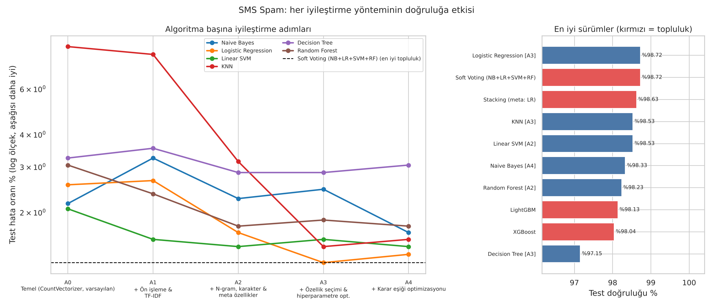
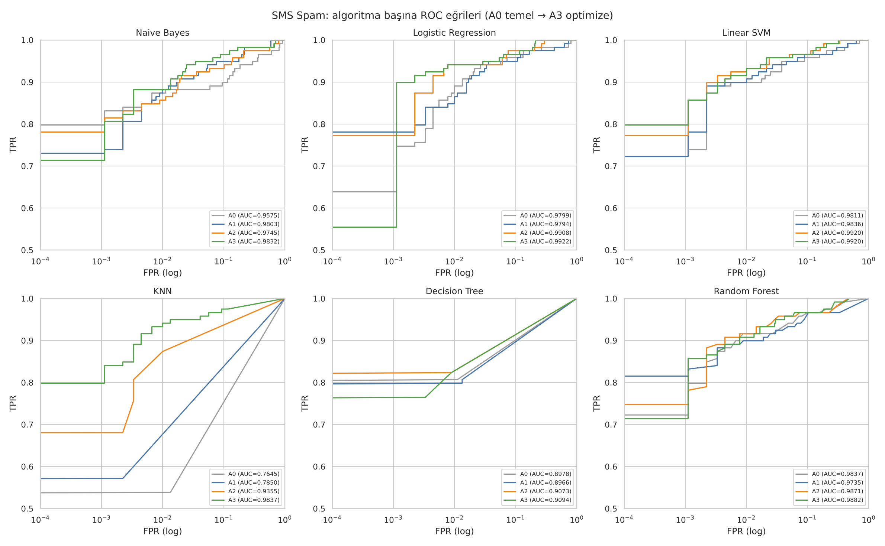

## 6. Çalıştırma

```bash
pip install -r ../requirements.txt            # xgboost ve lightgbm opsiyoneldir
python avucluhocaodev2/improve_accuracy.py                 # Enron-Spam (4 çekirdekte ~80 dk)
python avucluhocaodev2/improve_accuracy.py --dataset sms   # SMS Spam (~3 dk)
python avucluhocaodev2/improve_accuracy.py --quick         # 3.000 örneklik hızlı deneme (~5 dk)
python avucluhocaodev2/improve_accuracy.py --replot        # özet grafikleri CSV'den yeniden çiz
pytest -q avucluhocaodev2/tests
```

Dosyalar:

```
avucluhocaodev2/
├── improve_accuracy.py        # deney: A0-A4 aşamaları, topluluk yöntemleri, ROC grafikleri
├── tests/test_improve.py      # birim testleri
└── results/
    ├── stage_results.csv      # tüm model × aşama sonuçları
    ├── accuracy_by_stage.csv  # doğruluk özet tablosu
    ├── ensemble_results.csv   # topluluk yöntemleri
    ├── summary.txt, run_log.txt
    ├── roc/roc_<algoritma>.png    # her algoritmanın ROC eğrisi (A0-A3 + çalışma noktaları)
    ├── roc_all_algorithms.png     # 6 algoritmanın ROC eğrileri tek sayfada
    ├── roc_final_comparison.png   # optimize modeller + topluluklar
    ├── accuracy_ladder.png, errors_heatmap.png
    └── sms/                       # aynı deney SMS veri setinde
```

## Kaynaklar

* D. H. Wolpert. *Stacked generalization.* Neural Networks 5(2), 1992.
* L. Breiman. *Random Forests.* Machine Learning 45, 2001.
* T. Chen, C. Guestrin. *XGBoost: A Scalable Tree Boosting System.* KDD 2016.
* G. Ke vd. *LightGBM: A Highly Efficient Gradient Boosting Decision Tree.* NeurIPS 2017.
* M. Radovanović, A. Nanopoulos, M. Ivanović. *Hubs in Space: Popular Nearest Neighbors in High-Dimensional Data.* JMLR 11, 2010.
* T. Fawcett. *An introduction to ROC analysis.* Pattern Recognition Letters 27, 2006.
