# Avuçlu Hoca — Flutter Ödevi

> **Ödev:** Register (kayıt) ve login (giriş) ekranı yapılacak, giriş yapınca **"Merhaba Hakan"** yazdırılacak.

Ödevin istediği kayıt → giriş → "Merhaba Hakan!" akışı eksiksiz çalışıyor. Bunun üzerine uygulama,
öğrencinin derslerini, ödevlerini, not ortalamasını ve çalışma sürelerini takip eden bir
**öğrenci asistanına** dönüştürüldü. Bütün veriler cihazda saklanıyor, internet bağlantısı gerekmiyor.

| Giriş | Kayıt | Giriş sonrası |
|:---:|:---:|:---:|
| 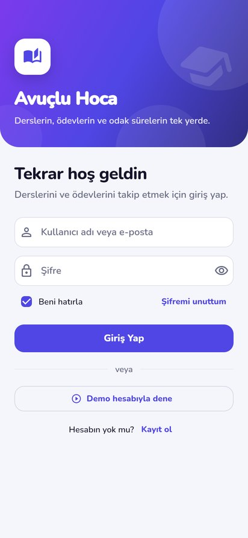 | 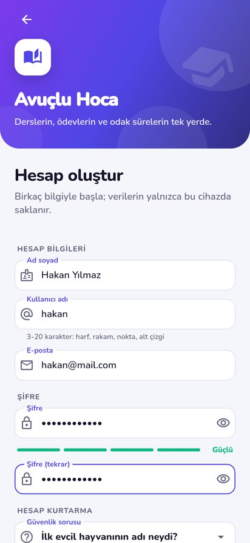 | 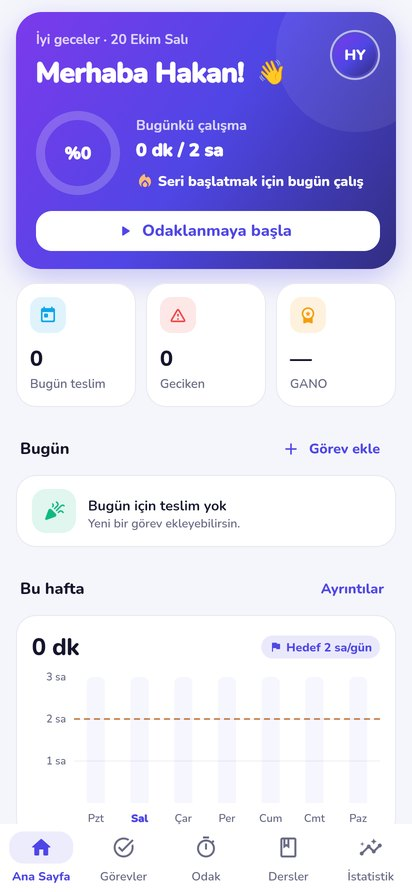 |

## Ödevin karşılığı

| İstenen | Uygulamadaki karşılığı |
|---|---|
| Register ekranı | [`register_screen.dart`](lib/screens/auth/register_screen.dart): ad soyad, kullanıcı adı, e-posta, şifre + tekrar, şifre gücü göstergesi, güvenlik sorusu, okul/bölüm, onay kutusu ve her alan için doğrulama |
| Login ekranı | [`login_screen.dart`](lib/screens/auth/login_screen.dart): kullanıcı adı **veya** e-posta ile giriş, şifreyi göster/gizle, "beni hatırla", "şifremi unuttum", demo hesabı |
| Giriş yapınca "Merhaba Hakan" | [`dashboard_screen.dart`](lib/screens/home/dashboard_screen.dart): kayıtta yazılan adın ilk kelimesiyle **"Merhaba Hakan!"** (ad küçük harfle yazılsa da Türkçe kurallarıyla "Hakan" olur) |
| Test | [`auth_flow_test.dart`](test/auth_flow_test.dart): kayıt ol → çıkış yap → hatalı giriş → doğru giriş, her adımda ekranda "Merhaba Hakan!" aranır |

## Ekranlar

| Ana sayfa | Görevler | Görev ekleme | Odak sayacı |
|:---:|:---:|:---:|:---:|
| 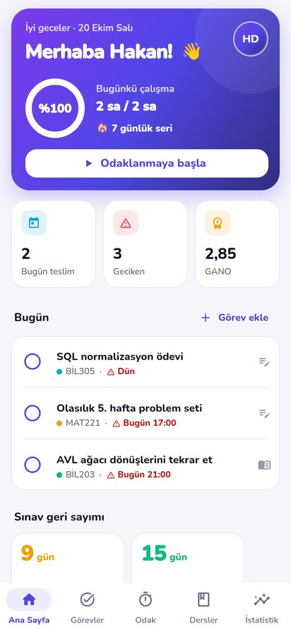 | 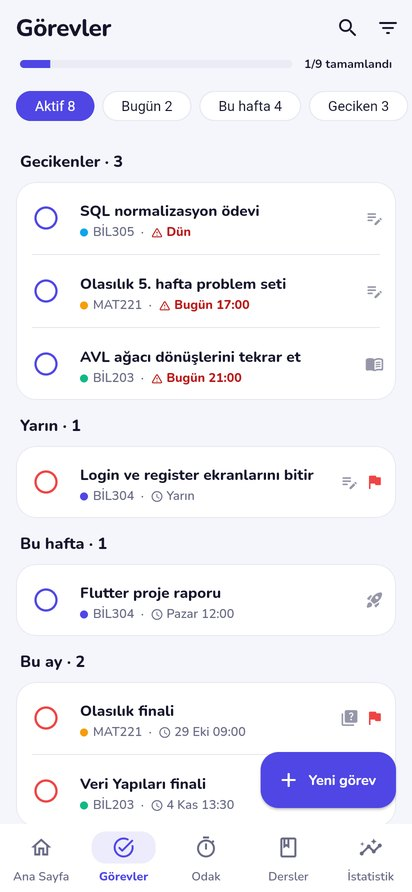 | 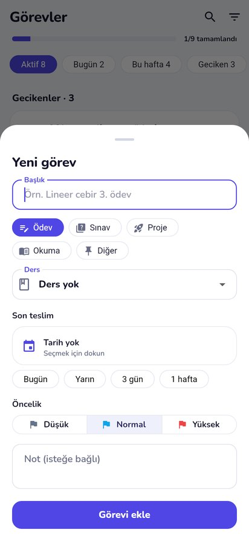 | 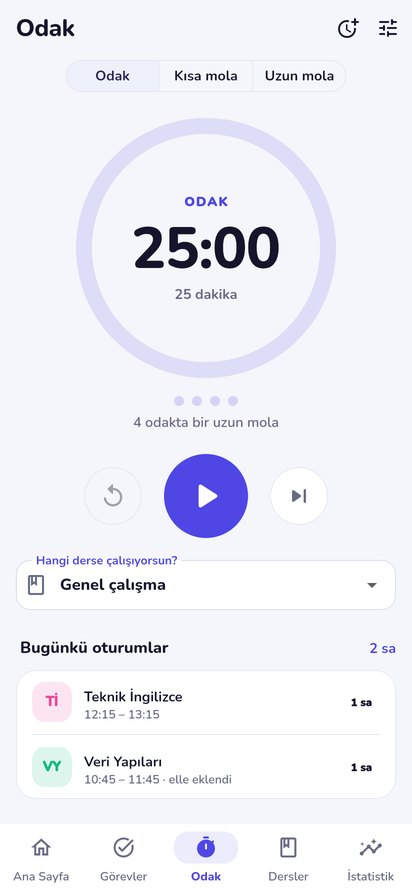 |

| Dersler ve GANO | Ders detayı | İstatistik | Koyu tema |
|:---:|:---:|:---:|:---:|
| 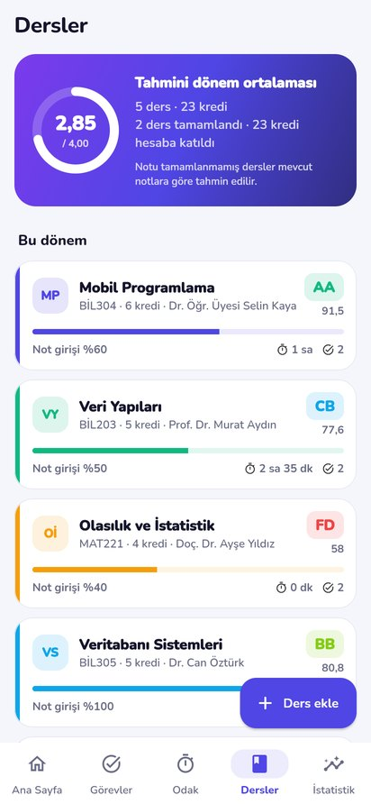 | 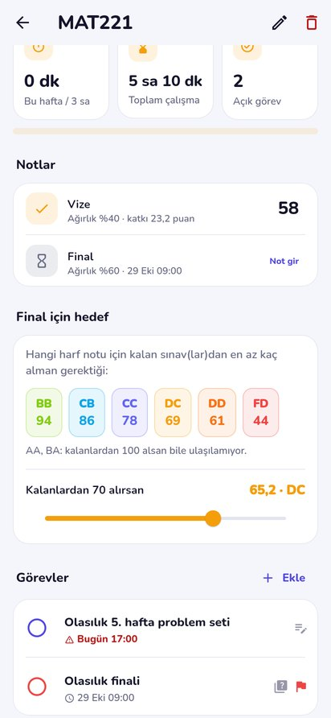 | 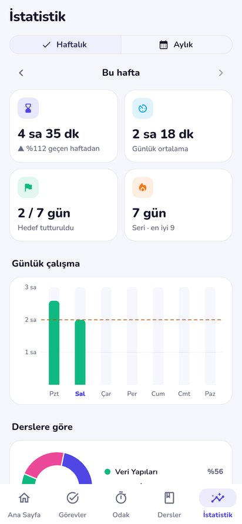 | 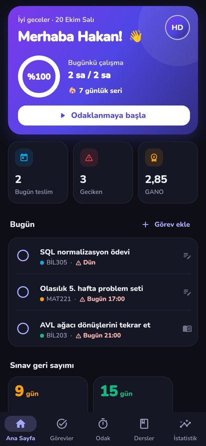 |

## Özellikler

### Hesap ve güvenlik
- **Kayıt:** Her alan anlık doğrulanır. Kullanıcı adı ve e-posta tekrar kullanılamaz, şifre en az 8 karakterdir ve harf ile rakam içermek zorundadır. Şifre yazılırken 4 kademeli güç çubuğu görünür.
- **Giriş:** Kullanıcı adı veya e-posta ile yapılır, büyük/küçük harf fark etmez.
- **Kaba kuvvet koruması:** Kalan deneme hakkı gösterilir, 5 hatalı denemeden sonra hesap 30 saniye kilitlenir. Hata mesajı hangi bilginin yanlış olduğunu söylemez, böylece bir hesabın var olup olmadığı anlaşılamaz.
- **Şifre saklama:** Şifreler hiçbir zaman açık metin olarak tutulmaz. Kullanıcıya özel rastgele tuzla **PBKDF2-HMAC-SHA256** (10.000 tur) kullanılır, karşılaştırma sabit sürede yapılır. Hesaplama ayrı bir isolate'te yapıldığı için arayüz donmaz. Algoritma RFC 7914 test vektörüyle doğrulanmıştır.
- **Beni hatırla:** İşaretliyse oturum uygulama kapansa da açık kalır ve kullanıcı adı giriş formuna yazılır. İşaretli değilse oturum yalnızca o açılışta geçerlidir.
- **Şifremi unuttum:** Kayıtta seçilen güvenlik sorusuyla şifre sıfırlanır. Cevap da özetlenerek saklanır; büyük/küçük harf ve boşluk farkı önemsenmez. Cevap tahminle bulunamasın diye 5 yanlış cevaptan sonra sıfırlama 5 dakika kilitlenir.
- **Profil:** Ad, e-posta, okul ve bölüm düzenlenebilir. Şifre değiştirmek için mevcut şifre istenir. Hesap silinirse kullanıcının bütün verileri de silinir.
- Her kullanıcı yalnızca kendi verisini görür. Aynı cihazda birden fazla hesap açılabilir.

### Ana sayfa
- Saate göre selam (Günaydın, İyi akşamlar…), tarih ve **"Merhaba Hakan!"**
- Günlük çalışma hedefi halkası ve art arda çalışılan gün serisi 🔥
- Bugün teslim edilecek, geciken ve GANO sayaçları
- Bugünün ve gecikenlerin listesi (tek dokunuşla tamamlanır, geri alınabilir)
- Yaklaşan sınavlar için geri sayım kartları
- Haftalık çalışma grafiği (hedef çizgisi ile) ve "günün sözü"

### Görevler (ödev, sınav, proje, okuma)
- Aktif, Bugün, Bu hafta, Geciken ve Tamamlanan filtreleri; her birinde görev sayısı görünür
- Gecikenler, Bugün, Yarın, Bu hafta, Bu ay ve Tarihsiz başlıklarıyla gruplama
- Derse göre süzme ve Türkçe karakterlere duyarsız arama ("calisma" yazınca "çalışma" bulunur)
- Tür, ders, son teslim tarihi ve saati, hızlı tarih seçimi (Bugün, Yarın, 3 gün, 1 hafta), öncelik ve not
- Kaydırarak silme (geri alınabilir) ve ilerleme çubuğu

### Dersler ve not ortalaması
- Ders adı, kodu, öğretim üyesi, kredi/AKTS, renk ve haftalık çalışma hedefi girilir
- Değerlendirme kalemleri için hazır şablonlar var (Vize + Final, Vize + Ödev + Final, …). Ağırlıkların toplamı %100 değilse ders kaydedilmez
- Ağırlıklı ortalama, harf notu ve 4'lük sistemdeki katsayı hesaplanır, buradan kredi ağırlıklı **GANO** çıkarılır
- **"Finalden kaç almalıyım?"**: Her harf notu için kalan sınavlardan alınması gereken en düşük not gösterilir. Ulaşılamayan harfler ("100 alsan bile…") ve garanti olanlar ayrıca belirtilir
- **Ne olur simülatörü:** Kaydırıcıyla "Kalanlardan 70 alırsan ortalaman 65,2, harf notun DC olur" gibi senaryolar denenebilir

| Harf | AA | BA | BB | CB | CC | DC | DD | FD | FF |
|---|---|---|---|---|---|---|---|---|---|
| Ortalama | 90–100 | 85–89 | 80–84 | 75–79 | 70–74 | 65–69 | 60–64 | 50–59 | 0–49 |
| Katsayı | 4,0 | 3,5 | 3,0 | 2,5 | 2,0 | 1,5 | 1,0 | 0,5 | 0 |

### Odak sayacı (Pomodoro)
- Odak, kısa mola ve uzun mola evreleri vardır. Süreler ve uzun molanın kaç odakta bir verileceği ayarlanabilir
- Kalan süre bitiş anından hesaplanır. Bu yüzden uygulama arka plana atılsa da sayaç kaymaz
- Sekme değiştirilince sayaç durmaz. Çalışırken alt menüde bir nokta görünür, evre bitince her ekranda bildirim çıkar
- Biten odak seçili derse çalışma oturumu olarak kaydedilir. "Bitir ve kaydet" ile erken bitirilen süre de kaydedilir
- Sayaç kullanılmadan yapılan çalışmalar elle eklenebilir

### İstatistik
- Haftalık ve aylık görünüm arasında geçilebilir, önceki dönemlere dönülebilir
- Toplam çalışma ve önceki dönemle değişimi (yalnızca aynı sayıda gün karşılaştırılır), günlük ortalama, hedefin tutturulduğu günler, güncel seri ve en iyi seri
- Günlük sütun grafiği, dersler arası pasta grafiği, saatlere göre ısı şeridi ("En çok 10:00–11:00 arasında çalışıyorsun")
- Tamamlanan görev sayısı ve zamanında teslim oranı

### Diğer
- Açık, koyu ve sistem teması; tercih kullanıcıya göre saklanır
- Bütün metinler, tarihler ve sayı biçimleri Türkçedir (`20 Ekim Salı`, `3,46`)
- **Demo hesabı:** Giriş ekranındaki "Demo hesabıyla dene" düğmesi 5 ders, 9 görev ve son 4 haftaya ait çalışma kayıtlarıyla dolu bir hesap açar (kullanıcı adı `demo`, şifre `demo1234`)

## Mimari

```
lib/
├── main.dart                 # Türkçe tarih biçimleri, veritabanını açar
├── app.dart                  # Provider'lar, tema, oturuma göre giriş ekranı / ana sayfa
├── theme.dart                # Material 3 tema (açık + koyu), Nunito yazı tipi
├── data/
│   ├── key_value_store.dart  # Depolama arayüzü + bellek içi uygulaması + JSON koleksiyon
│   ├── app_database.dart     # Hive kutuları (Android/iOS: dosya, web: IndexedDB)
│   └── demo_seed.dart        # Demo hesabı ve örnek veriler
├── models/                   # AppUser, Course/Assessment, StudyTask, StudySession, UserSettings
├── services/                 # Saf Dart iş mantığı (arayüzden bağımsız, birim testli)
│   ├── password_hasher.dart  # PBKDF2-HMAC-SHA256
│   ├── password_strength.dart
│   ├── validators.dart       # Form doğrulama kuralları
│   ├── grade_calculator.dart # Ortalama, harf notu, GANO, "finalden kaç?"
│   ├── study_stats.dart      # Seri, günlük toplam, ders/saat dağılımı, görev filtreleri
│   └── pomodoro_engine.dart  # Saati dışarıdan alan sayaç durum makinesi
├── state/                    # ChangeNotifier denetleyicileri (provider)
│   ├── auth_controller.dart  # Kayıt, giriş, kilitleme, sıfırlama, profil
│   ├── owned_collection.dart # Oturumdaki kullanıcının kayıtlarını tutan ortak sınıf
│   ├── data_controllers.dart # Ders, görev, çalışma oturumu
│   ├── settings_controller.dart
│   └── focus_controller.dart # Sayacı uygulama genelinde çalıştırır
├── screens/                  # auth, home, tasks, focus, courses, stats, profile
├── widgets/                  # Ortak bileşenler, görev satırı, haftalık grafik
└── utils/                    # Türkçe biçimlendirme ve büyük/küçük harf, kimlik üretimi, sözler
```

- **Durum yönetimi:** `provider` + `ChangeNotifier`. Veri denetleyicileri oturumu dinler; kullanıcı değişince kendi verilerini yeniden yükler.
- **Depolama:** `hive_ce`. Kayıtlar JSON olarak saklanır. Depo bir arayüzün (`KeyValueStore`) arkasında olduğu için testler aynı kodu bellek içi depoyla çalıştırır.
- **Test edilebilirlik:** Şifreleme, not hesabı, istatistik ve sayaç arayüzden ayrı saf Dart sınıflarıdır. Saat dışarıdan verildiği için testlerde zaman ileri sarılabilir (ör. kilidin 30 sn sonra açılması, pomodoro'nun bitmesi).

## Testler

```
flutter test     # 84 test
```

| Dosya | Kapsam |
|---|---|
| `auth_flow_test.dart` | **Kayıt → "Merhaba Hakan!" → çıkış → hatalı giriş → giriş**, demo hesabı, görev ekleme/tamamlama |
| `auth_controller_test.dart` | Kayıt çakışmaları, ayrılmış "demo" adı, kullanıcı adı/e-posta ile giriş, 5 denemede kilit, beni hatırla, şifre sıfırlama (ve sıfırlama kilidi)/değiştirme, profil, kullanıcılar arası veri ayrımı, hesap silme |
| `password_test.dart` | PBKDF2 (RFC 7914 vektörü), şifre gücü, form doğrulamaları |
| `grade_calculator_test.dart` | Harf notu sınırları, ağırlıklı ortalama, "finalden kaç almalıyım?", GANO |
| `study_stats_test.dart` | Seri, günlük toplamlar, dağılımlar, görev filtre ve sıralaması, Türkçe biçimlendirme |
| `pomodoro_engine_test.dart` | Duraklatma, evre geçişleri, uzun mola, erken bitirme, ayar değişikliği |
| `screens_smoke_test.dart` | Bütün ekranlar demo verisiyle açılır; not girişi, ders ekleme, sayaç, tema, dar ekran (360 dp) taşma kontrolü |

## Çalıştırma

```bash
cd flutter_odev
flutter pub get
flutter run                 # bağlı emülatör/telefon
flutter run -d chrome       # web
flutter test                # testler
flutter build apk --release # Android APK
```

Flutter 3.47 / Dart 3.13 ile geliştirildi ve test edildi. Kullanılan paketler: `provider`, `hive_ce`,
`hive_ce_flutter`, `intl`, `crypto`, `fl_chart`. Yazı tipi: Nunito (SIL Open Font License,
[`assets/fonts/OFL.txt`](assets/fonts/OFL.txt)).
